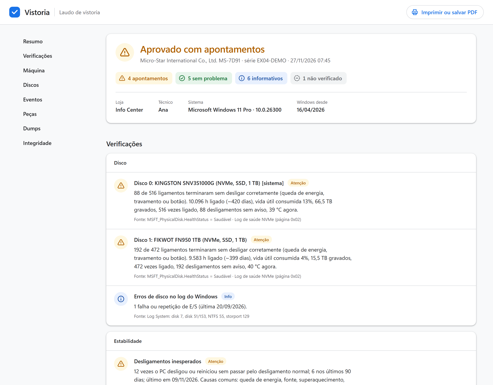

<div align="center">

# Vistoria

**Vistoria cautelar para PCs usados.**
Um `.exe` de 150 KB que roda do pendrive, lê o histórico que o hardware e o Windows guardam,
cruza as fontes atrás de contradições e entrega um laudo com a evidência de cada conclusão.

[](https://github.com/joshsegatt/vistoria/actions/workflows/ci.yml)


[](LICENSE)



</div>

---

Carro usado passa por vistoria cautelar antes da compra. PC usado não passa por nada: o vendedor formata,
diz que é "seminovo" e o comprador só descobre o SSD gasto ou a fonte que desarma meses depois.

O Vistoria lê o que **não some com a formatação** (o odômetro do SSD, os ciclos da bateria) e o que o
Windows registrou desde a última instalação (telas azuis, erros de hardware, peças trocadas, logs apagados).
Depois aponta o que não bate.

## Em 30 segundos

1. Baixe `Vistoria.exe` na [página de releases](https://github.com/joshsegatt/vistoria/releases) e copie para um pendrive.
2. No PC examinado, dê dois cliques. Aceite o pedido de administrador (sem ele, a coleta sai parcial e o laudo avisa).
3. Em menos de um minuto o laudo fica pronto no pendrive, em `vistorias\<data>_<máquina>\relatorio.html`. Abra no seu computador: abrir na máquina examinada deixaria histórico do navegador nela (se não se importar, use `--abrir`).

```powershell
.\Vistoria.exe --loja "Info Center" --tecnico "Ana"
```

| Opção | Efeito |
|---|---|
| `--loja "Nome"` | nome da loja no laudo |
| `--tecnico "Nome"` | técnico responsável, no laudo e no manifesto |
| `--saida <pasta>` | onde gravar (padrão: `vistorias\` ao lado do exe) |
| `--sem-admin` | não pede UAC; itens que exigem admin saem como **não verificado** |
| `--abrir` | abre o laudo no navegador ao terminar (grava histórico do navegador na máquina examinada) |

## O que ele verifica

**Disco** (SMART ATA, log de saúde NVMe, contadores de confiabilidade do Windows)
- Setores realocados, pendentes e irrecuperáveis; erros de mídia NVMe; alerta crítico do controlador
- Vida útil consumida, TB gravados, horas ligado, vezes ligado
- **Desligamentos sem aviso** em relação ao total de vezes ligado: queda de energia, fonte ou travamento
- Blocos defeituosos, corrupção de NTFS e resets de controladora no log do Windows

**Estabilidade e hardware** (log System + dumps do kernel)
- Telas azuis, com o código lido do evento e do cabeçalho do dump, e a peça que cada código costuma indicar (RAM, disco, GPU, CPU)
- Erros WHEA: o próprio processador, a memória ou o PCIe reportando falha
- Desligamentos inesperados (Kernel-Power 41) e travamentos do driver de vídeo (TDR)

**Bateria** (dados ACPI, os mesmos do `powercfg /batteryreport`)
- Capacidade atual comparada à de fábrica, e ciclos de carga

**Adulteração**
- Logs do Windows apagados (System 104 / Security 1102)
- Relógio atrasado mais de 24 h (Kernel-General 1)

**Histórico e peças**
- Data da primeira instalação do Windows, sobrevivendo a upgrades (`HKLM\SYSTEM\Setup\Source OS`)
- Processadores, placas de vídeo e discos que **já estiveram na máquina e não estão mais**, com datas (SetupAPI)
- Pentes de RAM misturados
- O período que o histórico cobre, para ninguém confundir "não tem registro" com "nunca aconteceu"

## O cruzamento que pega a formatação

Um disco não pode ter ficado ligado mais horas do que o tempo de calendário desde que o Windows foi instalado nele.

> O disco do sistema tem **10.096 h ligado** (~420 dias), mas o Windows mais antigo registrado é de **16/04/2026** (225 dias atrás).
> O Windows foi reinstalado num disco já usado: o histórico de antes de 16/04/2026 foi apagado.

As horas vêm do firmware do SSD, que a formatação não zera. A data vem do registro, inclusive das instalações
anteriores que os upgrades do Windows guardam. Quando as duas não batem, o laudo diz.

## Princípios forenses

- **Somente leitura.** Nada é gravado na máquina examinada e nenhum processo externo é chamado. Os discos são abertos sem direito de leitura ou escrita, só para consultas de status.
- **Toda conclusão cita a fonte:** log e ID do evento, atributo SMART, chave de registro, arquivo de dump. Um teste automatizado garante isso.
- **"Não verificado" nunca vira "OK".** Fonte que não pôde ser lida aparece com o motivo. Se nada de errado foi achado mas o disco ou o histórico de estabilidade não foram lidos, o veredito é **Inconclusivo**, nunca "Aprovado".
- **Uma tela azul é uma tela azul.** O mesmo travamento aparece no evento 1001, no minidump e no MEMORY.DMP; o Vistoria conta uma vez só. Erro em pendrive ou cartão SD não reprova a máquina, e o próprio pendrive do Vistoria fica fora do veredito.
- **Histórico antigo não reprova sozinho.** Erro de hardware (WHEA) ou tela azul repetida só reprova se ainda acontece nos últimos 90 dias; antes disso vira apontamento, porque a peça pode já ter sido trocada.
- **Cadeia de custódia.** `evidencias.json` guarda tudo o que foi lido, em bruto. `manifesto.txt` traz o SHA-256 de cada arquivo, horários em UTC, a versão e o operador. O hash da evidência também sai impresso no laudo.

```powershell
Get-FileHash .\evidencias.json   # tem que bater com o laudo e o manifesto
```

## O que ele não faz (de propósito)

- **Não abre arquivos pessoais**, histórico de navegação nem atividade do usuário. É dado pessoal (LGPD) e não diz nada sobre a saúde da máquina.
- **Não recupera arquivos apagados.** Em SSD com TRIM isso não funciona, e seria dado pessoal.
- **Não faz teste de estresse.** Ele lê histórico; para forçar o hardware, use OCCT ou MemTest86+.

## Limitações conhecidas

- Discos USB e controladoras RAID costumam esconder o SMART. O laudo marca esses discos como não verificados.
- O histórico do Windows some numa reinstalação limpa. O laudo mostra o período coberto e usa o SMART, que sobrevive, para apontar a lacuna.
- Ciclos de bateria dependem do firmware informar. Quando não informa, o laudo diz isso.
- Validado em hardware real (Windows 11, NVMe) sem administrador, e a cada push em máquinas virtuais Windows Server 2022 e 2025 como administrador (job `vm` do CI). Ainda falta rodar como admin em hardware real com SSD SATA e em notebook com bateria; relatos de máquinas reais são bem-vindos nas issues.
- Desgaste de SSD SATA pelo SMART (atributos 231, 233, 177) aparece como estimativa e não muda o veredito: cada fabricante usa esses números de um jeito.

## Compilar

Requer o .NET SDK 9.0.200 ou mais novo (por causa do `Vistoria.slnx`), no Windows.

```powershell
dotnet test
dotnet build src/Vistoria -c Release
# src/Vistoria/bin/Release/net472/Vistoria.exe
```

Teste ponta a ponta (numa VM, ou como administrador para cobrir tudo): roda o exe três vezes e confere pastas, hashes do manifesto e a fonte de cada verificação.

```powershell
pwsh tests/smoke.ps1 -Exe src/Vistoria/bin/Release/net472/Vistoria.exe -Out $env:TEMP\vistoria-smoke
```

O alvo é o .NET Framework 4.7.2, que já vem no Windows 10 (1803+) e no Windows 11. Resultado: um exe só,
sem instalador e sem DLL ao lado. AnyCPU: o mesmo binário roda em 32 e 64 bits.

```
src/Vistoria/
  Program.cs          argumentos, UAC, orquestração, saída e manifesto
  Evidence.cs         modelo do que foi coletado (UTC)
  Collectors/         Machine, Disks, Battery, Events, Devices, Dumps — só leem
  Rules.cs            verificações puras: Evidence → Checks → veredito
  Report.cs           laudo HTML autocontido
  Json.cs             serializador mínimo, sem dependência
tests/Vistoria.Tests/ regras, parsers (SMART, NVMe, dump, bugcheck), JSON, aspas do UAC
docs/PLANO.md         user stories, princípios e fontes
```

Novas regras entram em `Rules.cs`, com teste em `tests/`. Novas fontes entram em `Collectors/`, sempre dentro de `Guard.Try`.

## Licença

[MIT](LICENSE).

---

<details>
<summary><strong>English</strong></summary>

**Vistoria** is a pre-purchase inspection for used Windows PCs: a single 150 KB, dependency-free `.exe`
(.NET Framework 4.7.2) that runs from a USB stick. It reads what survives a reformat (SSD/HDD SMART and NVMe
health logs, battery wear and cycles), plus what Windows recorded since its install (bugchecks with codes from
event 1001 and dump headers, WHEA hardware errors, unexpected shutdowns, GPU TDRs, cleared event logs,
clock rollbacks, and CPUs, GPUs and disks that were once installed and are now gone, via SetupAPI). It then cross-checks the sources,
for example disk power-on hours against the earliest recorded Windows install date, to expose reformatted machines.

It is strictly read-only, every finding cites its source, unreadable sources are reported as *not verified*
(never "OK"), and each run produces raw `evidencias.json` and a SHA-256 manifest for chain of custody.
The UI and report are in Brazilian Portuguese.

</details>
